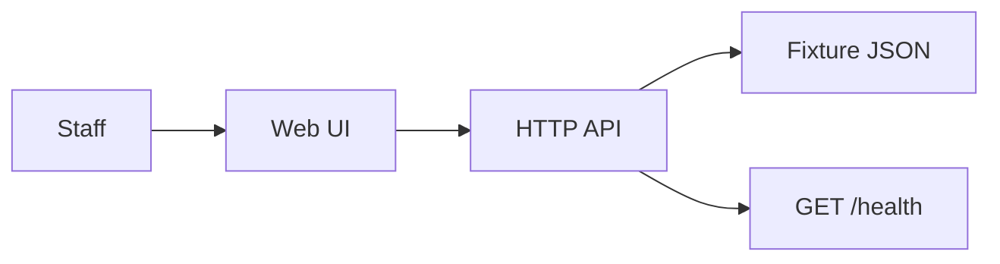
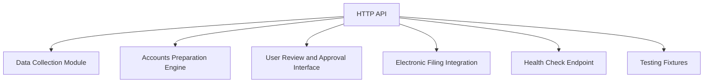
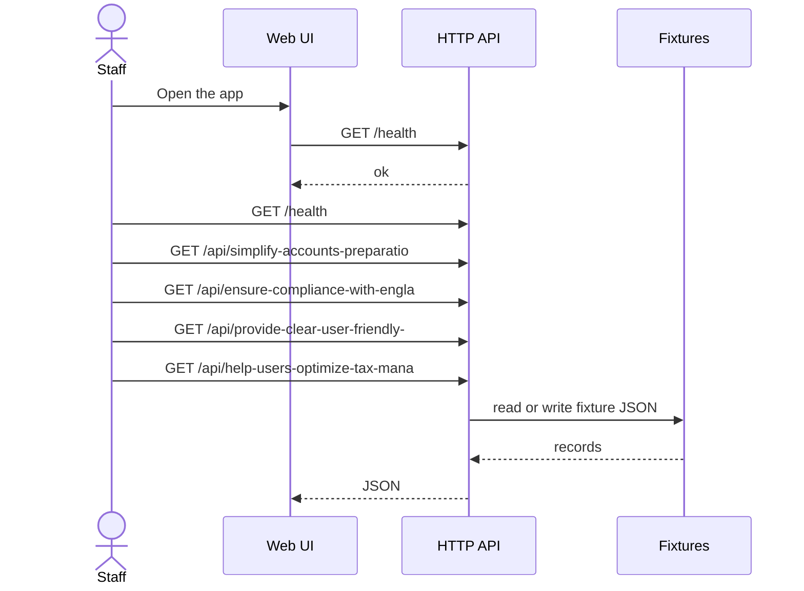

# APPLICAT-1 — Application to Prepare and File Accounts for Small Limited Companies in England

## Intent
Problem
It is for small limited Companies registered in England.
Who it is for
Farm and packhouse teams
What version one does
Ideas is we need an application which can Prepare accounts of a limited company as per England HMRC rules and make them ready to file.
In scope
Guided data collection including bank transactions and other inputs.
Preparation of draft and final accounts as per HMRC requirements.
User review and approval workflow for final accounts.
Electronic filing of returns following HMRC procedures.
Out of scope
Accounting services for companies outside England.
Manual bookkeeping or bank transaction processing.
Tax advice beyond general efficiency suggestions.
Support for complex corporate structures or audits.

This file is the approved architecture. Code is written from this document. Revise it until you approve.

## Ticket comments
- Sesh A: APPLICAT-1 is code review. Project folder written at /app/data/delivery-workspaces/m6zllynbWEiU using Azure OpenAI. Open the workbench, then proceed for testing.
- Sesh A: APPLICAT-1 is deploy approval. The pull request is ready. Waiting for deploy approval.
- Sesh A: APPLICAT-1 is completed. Deploy is approved. I reused Git connection “FileAccountsUK”. Open Connections, then Pipeline — attach that connection, set Infra to Use existing, and Run pipeline. Shipdeck will not create a new cloud until you choose.
- Sesh A: APPLICAT-1 is architecture review. Live usage this call: 1561 tokens
- Sesh A: APPLICAT-1 is writing code. Now: calling Azure OpenAI to write the project files. This can take a minute.
- Sesh A: APPLICAT-1 is code review. Project folder written at /app/data/delivery-workspaces/WXyrjPbmukaY using Azure OpenAI. Open the workbench, then proceed for testing.
- Sesh A: APPLICAT-1 is deploy approval. The pull request is ready. Waiting for deploy approval.
- Sesh A: APPLICAT-1 is completed. Deploy is approved. Open Connections, then Pipeline — attach that connection, set Infra to Use existing, and Run pipeline. Shipdeck will not create a new cloud until you choose.

## System context

## Components

- **Data Collection Module** (node) — Guide users through collecting bank transactions and other financial inputs
- **Accounts Preparation Engine** (python) — Prepare draft and final accounts according to HMRC requirements
- **User Review and Approval Interface** (node) — Provide workflow for user review and approval of final accounts
- **Electronic Filing Integration** (python) — Handle electronic filing of returns following HMRC procedures
- **Health Check Endpoint** (node) — Provide GET /health endpoint for system health monitoring
- **Testing Fixtures** (python) — Provide fixture data for unit and integration testing
- **Fixture store** — JSON under `fixtures/`. No production database.

## APIs

| Method | Path | Purpose |
| --- | --- | --- |
| GET | `/health` | Deploy verify — report ok |
| GET | `/api/simplify-accounts-preparatio` | Simplify accounts preparation for small limited companies. |
| GET | `/api/ensure-compliance-with-engla` | Ensure compliance with England HMRC accounting and filing standards. |
| GET | `/api/provide-clear-user-friendly-` | Provide clear, user-friendly guidance throughout the process. |
| GET | `/api/help-users-optimize-tax-mana` | Help users optimize tax management efficiently. |

## Request flow

## Technologies
- node
- python

After approval, the change stays inside this repository. Languages: node, python. Packages: https://registry.npmjs.org, https://pypi.org. License: MIT, Apache-2.0, BSD-3-Clause.

## In scope
- Simplify accounts preparation for small limited companies.
- Ensure compliance with England HMRC accounting and filing standards.
- Provide clear, user-friendly guidance throughout the process.
- Help users optimize tax management efficiently.

## Out of scope
- Production data access
- Work outside this ticket
- A pull request unless auto-open is enabled

## Assumptions
- The application targets only small limited companies registered in England.
- Users are primarily farm and packhouse teams with limited accounting expertise.
- HMRC rules and filing procedures are stable and accessible for integration.
- Existing Git connection 'FileAccountsUK' and infrastructure will be reused for deployment.
- The application will not provide manual bookkeeping or complex tax advice.
- The system will comply with platform policies for testing and health checks.

## Deploy
After lint, unit, and integration, and after deploy approval, pick Git and a cloud, then run the pipeline. Target **dev**. Rollback owner: **Platform on-call**.

## Planner notes
## Architecture Overview

The application will be a guided workflow system that collects financial data, prepares accounts compliant with HMRC standards, allows user review and approval, and files returns electronically. It will include:

- Data Collection Module
- Accounts Preparation Engine
- User Review and Approval Interface
- Electronic Filing Integration

The system will expose a health check endpoint (`GET /health`) and include fixture data for testing. CI/CD pipelines will use existing Git connections and infrastructure as per deployment notes.

